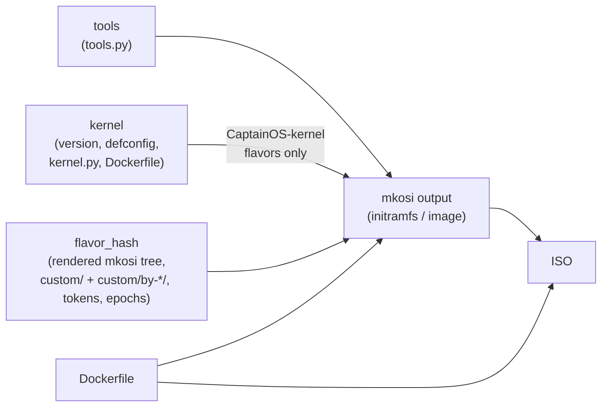
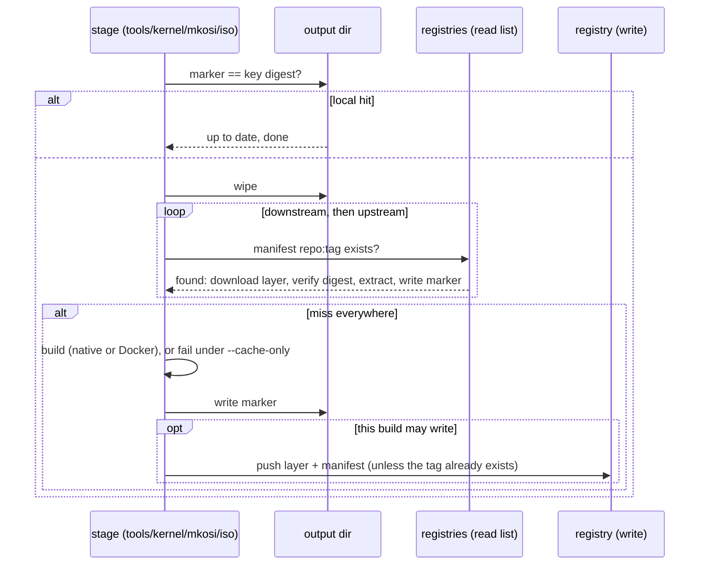
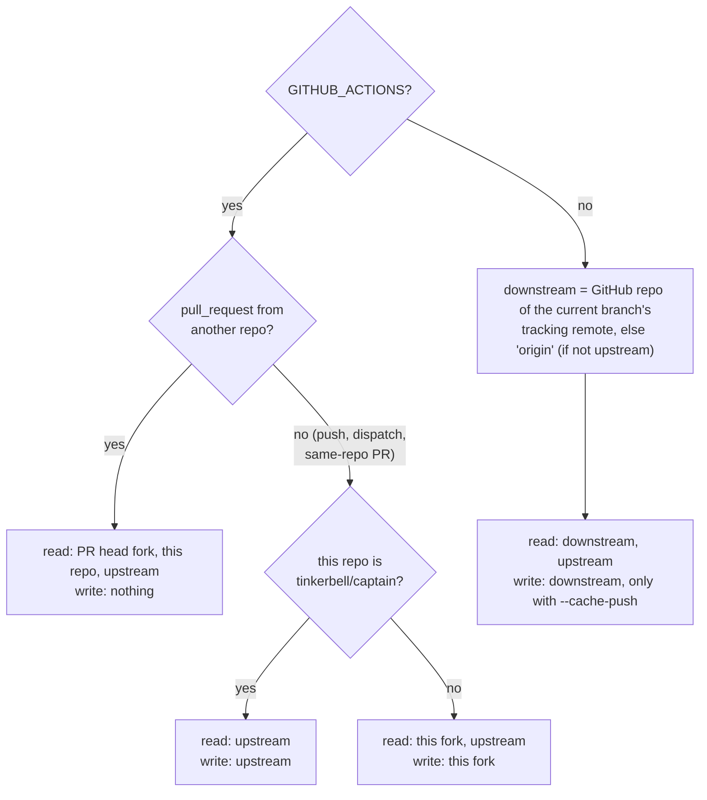
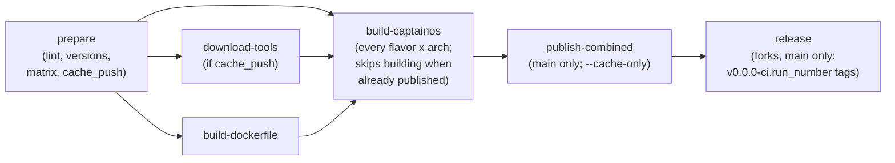

# Build caching

CaptainOS caches every expensive build piece as an OCI artifact in a container registry
(`ghcr.io` by default). The same cache serves GitHub Actions and local builds, on any host.

- **Content-hashed**: an entry's key is a hash of its declared inputs only — never git revisions,
  hostnames, paths or timestamps. A rebuild with only doc/CI-YAML changes resolves to the same
  keys, and finishes fast.
- **Two levels**: a *downstream* cache (a fork, eg. `ghcr.io/rpardini/captain`) is tried first,
  then the *upstream* one (`ghcr.io/tinkerbell/captain`). A build only ever writes to its own level.
- **ORAS-style artifacts**: an OCI image manifest with an `artifactType`, an empty config, and a
  single layer: a deterministic tar of the piece's output directory (file modes kept).

The implementation lives in `captain/cache/` (pure Python; no `oras`, `skopeo` or Docker needed
to read or write the cache).

## What is cached

| Piece | Repository | Output directory | Key inputs |
|---|---|---|---|
| tools | `cache/tools` | `mkosi.input/tools/<arch>` | arch; `tools.py` (holds the pinned `TOOLS` manifest) |
| kernel | `cache/kernel` | `mkosi.input/kernel/<arch>` | arch; kernel version; defconfig; `kernel.py`; `Dockerfile` (toolchain) |
| mkosi output | `cache/initramfs`, `cache/image` | `mkosi.output/<kind>/<flavor>/<arch>/<flavor_hash>` | arch; flavor id; `flavor_hash` (the whole rendered mkosi tree: traits, `custom/` and matching `custom/by-*/` dirs, cache-bust tokens such as the Armbian repo version, Kubernetes version, distro epochs); tools key; kernel key (CaptainOS-kernel flavors); RPi firmware tag (Raspberry Pi flavors); `Dockerfile` (mkosi version, apt/dnf); `cli/stages.py`, `docker.py` |
| ISO | `cache/iso` | `mkosi.output/iso/<flavor>/<arch>/<flavor_hash>` (minus `staging/`) | mkosi key; `iso.py`; `Dockerfile` (grub) |

Repositories are under the cache location, eg. `ghcr.io/tinkerbell/captain/cache/kernel`. Tags are
`<name>-<arch>-<first 24 hex of the key digest>`, eg. `linux-6.18.39-amd64-671da3c1d602fda942dc51bc`
or `trixie-slim-arm64-6fa6019f6de405df4f374228`.

Every key also folds in `CACHE_SCHEMA` (artifact format) and `CACHE_EPOCH` (see
[Forcing rebuilds](#forcing-rebuilds)). The full canonical inputs are stored in each manifest's
`io.tinkerbell.captain.cache.inputs` annotation, and checked on pull.



The key graph means a cache hit high up skips everything below it: when a flavor's mkosi output is
cached, `captain build` doesn't download tools or build the kernel at all.

Captain's own Python modules are folded in per piece (the modules listed above), not wholesale, so
unrelated refactors don't rebuild everything. **When a change to another module alters what a piece
produces, add that module to its key** in `captain/cache/_keys.py` (or bump `CACHE_EPOCH`) — the
cache is only as trustworthy as these lists.

## How a piece is resolved

Each output directory holds a `.captain-cache-key` marker with the digest it was built or restored
for, so local re-runs are content-addressed too: a stale directory (eg. after a tool version bump)
is wiped and rebuilt, rather than reused because "the file exists".



Registry errors never fail a build: they are logged and treated as misses (or skipped pushes).
All remote cache work happens in the host process; the Docker-relaunched one only builds.

## Who reads and writes what



| Context | Reads | Writes |
|---|---|---|
| upstream repo: push to main / dispatch / same-repo PR | upstream | upstream |
| upstream repo: PR from a fork | fork, upstream | — |
| fork repo: push / dispatch / same-repo PR | fork, upstream | fork |
| fork repo: PR from a third repo | that repo, fork, upstream | — |
| local build | downstream (from git remotes), upstream | downstream, with `--cache-push` |

Same-repo PRs do write: the keys must fully describe the outputs, so a later main build can trust
entries pushed from a PR branch.

`captain cache info` shows the detected context, read/write locations, and every key of the
selected flavor/arch with where it was found:

```bash
uv run captain --flavor-id trixie-slim --arch arm64 cache info
```

## Options

| Option | Env | Meaning |
|---|---|---|
| `--cache on\|read\|off` | `CAPTAIN_CACHE` | `on` (default): read; push where allowed. `read`: never push. `off`: no remote cache (markers still apply). |
| `--cache-push` | `CAPTAIN_CACHE_PUSH` | Local builds: push what was built to the downstream cache. |
| `--cache-only` | `CAPTAIN_CACHE_ONLY` | Fail instead of building anything that is not cached. |
| | `CAPTAIN_CACHE_DOWNSTREAM` | Override the downstream location (`host/prefix`, eg. `localhost:5000/captain`). |
| | `CAPTAIN_CACHE_UPSTREAM` | Override the upstream location; `none` disables it. |
| | `CAPTAIN_CACHE_TOKEN`, `GITHUB_TOKEN` | Token for `ghcr.io`. |
| | `REGISTRY_USERNAME`, `REGISTRY_PASSWORD` | Credentials for any registry. |
| | `REGISTRY_INSECURE=1` | Plain HTTP (implied for `localhost`). |

Otherwise, credentials come from the Docker config (`~/.docker/config.json`: `auths`,
`credHelpers`, `credsStore` — so `docker login ghcr.io` is enough, including the macOS keychain).
Public repositories need no credentials to read. `--force`, `--force-kernel`, `--force-tools` and
`--force-iso` skip restoring (but still push the fresh build, when allowed).

### Trying it with a throwaway registry

```bash
docker run -d --rm --name captain-cache -p 5000:5000 registry:2
export CAPTAIN_CACHE_DOWNSTREAM=localhost:5000/captain CAPTAIN_CACHE_UPSTREAM=none
uv run captain --flavor-id trixie-slim --cache-push build    # builds and pushes everything
rm -rf mkosi.input mkosi.output out
uv run captain --flavor-id trixie-slim build                 # restores everything; no kernel/mkosi run
curl -s localhost:5000/v2/_catalog
```

## Forcing rebuilds

Inputs that live outside the repository (distro package repositories) are not hashed. When they
matter — eg. a CVE fix landed in Debian — bump an epoch:

- one distro: pass `cache_epoch=N` to its trait in `captain/flavors.py`, eg. `Debian("trixie", cache_epoch=1)`;
  it is rendered as a cache-bust token into the flavor's mkosi config, so only its flavors rebuild;
- everything: bump `CACHE_EPOCH` in `captain/cache/_keys.py`.

The Armbian flavors already fold in the armbian-next repository version (`ARMBIAN_VERSION`), and the
CaptainOS kernel the latest kernel.org release of its branch (`KERNEL_VERSION`); see
[Version tokens](#version-tokens).

## Version tokens

`KERNEL_VERSION` (latest kernel.org release of the kernel branch) and `ARMBIAN_VERSION` (a token
from the armbian-next repository's `Release` ETag) are inputs to cache keys, so local builds and CI
must agree on them:

- **CI**: the `prepare` job resolves both once (`captain prepare-versions`) and passes them to every
  job, so a run is consistent even if upstream changes mid-run.
- **Local**: when not given, both are resolved the same way and cached in the gitignored
  `mkosi.input/.versions.json` for 6 hours, so kernel.org and armbian aren't hit on every
  invocation. When offline, a stale cached value is used; with no cache at all, the defaults
  (`DEFAULT_KERNEL_VERSION`, no armbian token) — whose keys won't match CI's.
- `--kernel-version` / `KERNEL_VERSION` and `--armbian-version` / `ARMBIAN_VERSION` override; delete
  `mkosi.input/.versions.json` to re-resolve right away.

## GitHub Actions



- The registry is the only hand-off between jobs: no workflow artifacts, and no build outputs in the
  GitHub Actions cache (which only holds uv itself; see below).
- In forks, each push to `main` ends with `release` (the reusable `release.yml`): OCI tags
  `v0.0.0-ci.<run number>[<suffix>]` for every flavor (and `v0.0.0-ci.<run number>-<flavor id>`, the
  per-commit tags' naming), by manifest re-tags (seconds). With the
  repository variable `CAPTAIN_FORK_GH_RELEASE=true`, also a GitHub prerelease with every flavor's
  artifacts, pulled, packed and uploaded one flavor at a time to keep the runner's disk usage
  bounded (~10 min more). Upstream `v*` tags always get the GitHub Release.
- Every job sets up uv through the local action `.github/actions/setup-uv`, which keeps the uv
  binary, CPython and the Python dependencies in the GitHub Actions cache, so jobs download nothing
  from astral.sh, python-build-standalone or PyPI; see `docs/gha-uv-python-deps-caching.md`.
- Building in a fork (customizations, versions, consuming the images): see
  `docs/fork-custom-builds.md`.
- `download-tools` is a cache warmer (tools are used by every flavor), run only when the run may
  push; otherwise (fork PRs) each build job downloads them itself on a miss.
- The CaptainOS kernel has no job of its own: only `trixie-slim` uses it, and its build jobs
  restore it from the cache or build (and push) it, so no other flavor waits on a kernel build.
- `publish-combined` restores both arches' outputs with `--cache-only`, so it never rebuilds.
- All jobs log in to `ghcr.io` with `GITHUB_TOKEN` (`permissions: packages: write`).
- The Docker builder image (`<repo>/builder:<arch>-<Dockerfile sha256>`) follows the same two levels:
  this repo's, then upstream's. `build-dockerfile` runs `captain builder --ensure-remote`, which only
  checks the registries (no pull) and builds/pushes only when neither has it; jobs that actually
  run something in Docker pull it from the first registry that has it.

### Release images: content tags

`captain release publish` publishes each image under a **content tag** in the `artifacts` repository,
derived from the build-cache keys of what it contains plus how it is packaged:
`c-<flavor>-<arch>-<digest>`, and `c-<flavor>-combined-<digest>` for the multi-arch image (whose
per-arch bases are the arches' content tags). When the content tag already exists, nothing is built
or pushed, and the builder isn't even pulled; either way, the image is then tagged with this
commit's source tag (`v0.0.0-<sha7>-<flavor>[-<arch>]`) by re-tagging its manifest (no blob
transfer), so `release pull` / `release tag` / `release.yml` keep working off source tags.

`captain release status [--github-output]` tells whether the content tag exists without needing any
build outputs; CI uses it to skip `captain build` (and `publish-combined`'s restores) entirely.

| Key | Inputs |
|---|---|
| per-arch release | mkosi key; ISO key (if any); `Dockerfile` (buildah); `artifacts.py`, `buildah.py`, `oci/_build.py`, `oci/_publish.py`, `traits/output/__init__.py`, `traits/platform/rpi.py` |
| combined release | both per-arch release keys |

### What to expect

Measured on a fork (October 2026, 28 flavor×arch builds, 10 combined publishes):

| Run | Wall time | Flavor build jobs | What happens |
|---|---|---|---|
| cold (empty cache) | ~40 min | ~2–6 min each (all but `trixie-slim` done ~13 min in); `trixie-slim` 11 min (arm64) / 19 min (amd64), as they also build the kernel | everything built and pushed; `publish-combined` restores all of it (`--cache-only`); in forks, `release` adds ~13 min |
| inputs unchanged (eg. doc-only commit) | ~3 min | 9–21 s each | each flavor finds its release image already published (content tag): no build, no restore, no builder pull; it only adds the commit's tag. `publish-combined` likewise (13–20 s each); the fork `release` job only re-tags (~50 s) |

For comparison, an unchanged run took ~8.5 min before content-tagged releases (every job restored its
outputs and republished through the builder image), and the fork `release` job took ~13 min when it
also created a GitHub Release: 105 assets (~9.7 GiB) for 18 flavors, uploaded one flavor at a time
with the runner's disk at ~22% used throughout.

What remains on a fully-cached run is fixed overhead: lint, the builder image job and runner start-up.

Keys computed locally match CI's (eg. `trixie-full-arm64-320c0c10…`), so a local build of an
unchanged flavor restores CI's outputs (within 6 hours of an upstream kernel/armbian release, local
and CI may briefly disagree; see [Version tokens](#version-tokens)).

### ghcr.io notes

- The `cache/*` packages are created by CI pushes with `GITHUB_TOKEN`, and their manifests carry
  `org.opencontainers.image.source`; so each package is connected to its repository and inherits
  its visibility (public for a public repo: local builds and forks read it anonymously), and the
  repository's `GITHUB_TOKEN` can keep pushing to it. No manual setup needed.
- ghcr.io answers anonymous requests for missing or private packages with HTTP 403; these count as
  misses.
- Nothing prunes old cache tags yet; clean them up from the package settings if needed.
