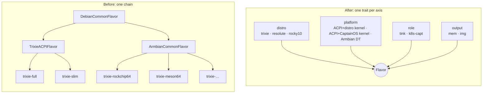
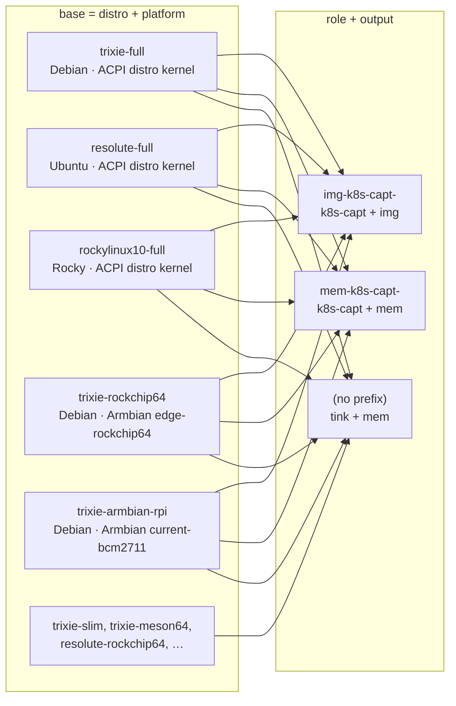
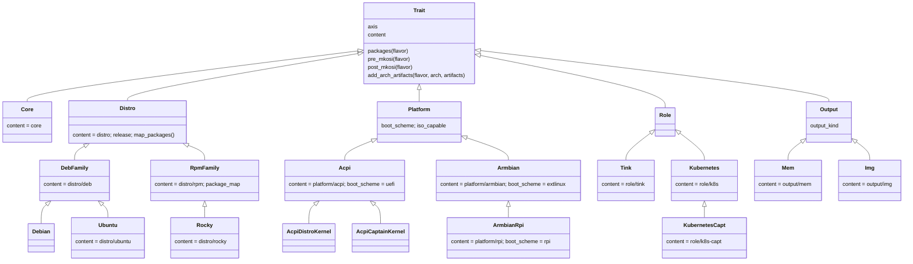
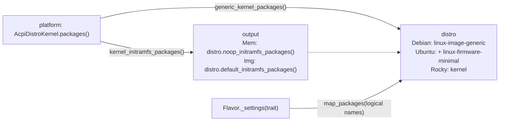
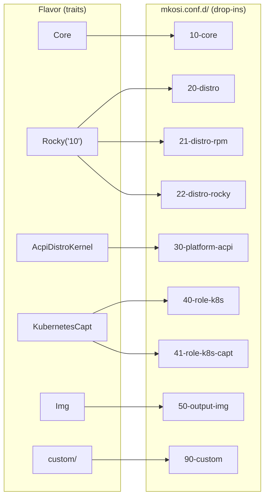
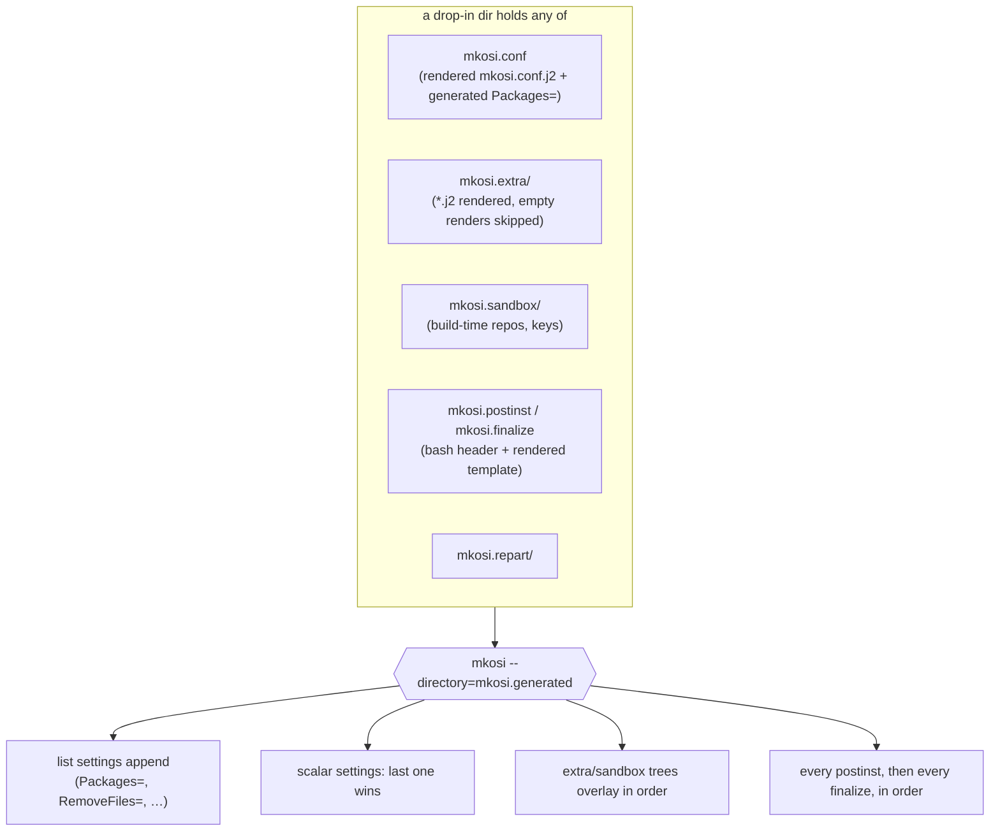
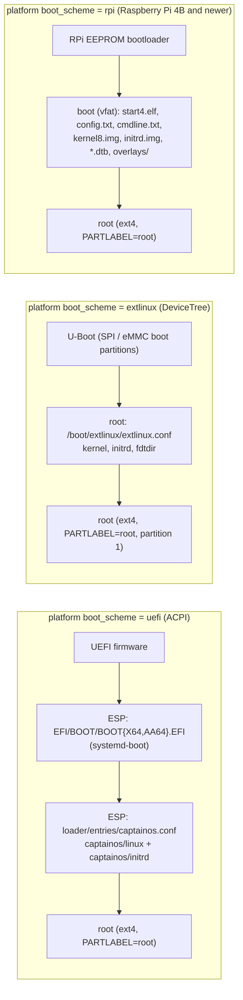

# Flavors as Compositions of Traits

## Context

Flavors started as a single inheritance chain (`DebianCommonFlavor > TrixieACPIFlavor | ArmbianCommonFlavor >
trixie-*`), with one Python module directory per flavor and a single Debian-only `mkosi.conf.j2`. Every flavor was
implicitly the same kind of thing: an in-memory (initramfs) Debian image running tink-agent.

We want to vary more than "which kernel":

- **distro**: Debian Trixie, Ubuntu Resolute, Rocky Linux 10 (so `.deb` and `.rpm`)
- **platform**: UEFI/ACPI with the distro kernel, UEFI/ACPI with the CaptainOS kernel, DeviceTree with Armbian kernels
- **role**: tink-agent provisioning, or a Kubernetes node (kubeadm + cloud-init)
- **output**: in-memory (kernel + initramfs) or a disk image for final deployment

A single inheritance chain cannot express that product without duplicating whole flavors, and mixins over four axes
make the MRO hard to follow.



## Decision

A flavor is a composition of one **trait** per axis, and is declared in a single explicit registry
(`captain/flavors.py`):

```python
Flavor(
    id="trixie-rockchip64",
    distro=Debian("trixie"),
    platform=Armbian("linux-image-edge-rockchip64"),
    role=Tink(),
    output=Mem(),
)
```

Existing flavor IDs are unchanged and are implicitly `mem` + `tink`. New role/output combinations get explicit
prefixes, e.g. `mem-k8s-capt-trixie-full` and `img-k8s-capt-trixie-rockchip64`, where `capt` is the variant of the
`k8s` role.

How flavor IDs map onto the axes; each `<base>` (distro + platform) is reused across roles and outputs:



### Traits

A trait (`captain/traits/__init__.py`) contributes:

- **packages**, as logical (Debian) names, which the distro maps to its own names (`iproute2` → `iproute` on Rocky);
- **content**: a directory with any of `mkosi.conf.j2`, `mkosi.postinst.sh.j2`, `mkosi.finalize.sh.j2`, `mkosi.extra/`,
  `mkosi.sandbox/`, `mkosi.skeleton/` and `mkosi.repart/`. Content is declared per class and collected along the MRO, so
  `Debian` gets `distro/` (generic `[Distribution]` settings) plus `distro/deb/` (apt bits). Inheritance is kept for
  "is a kind of" relationships within one axis (`ArmbianRpi(Armbian)`), never across axes.
- **hooks** (`pre_mkosi`, `post_mkosi`, `post_artifact_collect`), **artifacts**, and answers to flavor-wide questions
  (`keep_package_manager`, `keep_hwdb`, `cache_bust_token`, `cache_inputs`).
- **custom names** (`custom_names()`, and `Platform.kernel_names()`): the `custom/by-<axis>/<value>/` dirs it matches
  (see "User customizations" below).

The trait classes, by axis. Inheritance only ever happens *within* an axis; the boxes' `content` is the directory (under
`captain/traits/`) each class adds, collected along the MRO:



Traits answer cross-axis questions by asking the flavor: a platform that uses the distro kernel asks
`flavor.distro.generic_kernel_packages()`, and asks `flavor.output.kernel_initramfs_packages()` for whatever satisfies
the kernel's initramfs-generator dependency (a no-op for in-memory outputs, the distro's real generator for disk images).



### mkosi drop-ins

Each content directory becomes one mkosi **drop-in directory** under the disposable `mkosi.generated/mkosi.conf.d/`,
numbered by axis (`10-core`, `20-distro`, `21-distro-deb`, `30-platform-acpi`, `40-role-tink`, `50-output-mem`, ...,
`90-custom`). mkosi merges these natively: list settings (`Packages=`, `RemoveFiles=`) append, later scalar settings
win, `mkosi.extra`/`mkosi.sandbox` trees overlay in order, and every drop-in's `mkosi.postinst`/`mkosi.finalize` runs in
order. mkosi is invoked with `--directory=mkosi.generated`.

For example, `img-k8s-capt-rockylinux10-full` renders to these drop-ins (trait → content dirs along its MRO → drop-in):



Each drop-in is a self-contained mkosi config directory; mkosi merges them in order:



mkosi resolves relative paths in a drop-in's config against that drop-in directory, so project paths are rendered via
`flavor.project_relative()` (`../../../<path>`), which works natively and in the builder container alike.

### User customizations

The user's customizations are always the last drop-in (`90-custom`), merged from layers, general to specific:
`custom/` (every flavor), then `custom/by-<axis>/<value>/` for each matching value, in the order family, distro, arch,
role, output, platform, kernel, flavor (`captain/custom.py`). Each layer has the shape of `custom/` (`files/`,
`packages.txt`, `mkosi-postinst/`, `mkosi-finalize/`). They merge by name: packages add up, a same-path file or
same-named script in a later layer replaces an earlier one, and all scripts run together sorted by filename. Values
come from the traits (`custom_names()`: eg. `debian` and `debian-trixie`; `armbian` and `rpi`); a symlinked value dir
shares one flavor's layer with another. Only matching layers are rendered, so they only change matching flavors'
`flavor_hash`.

```mermaid
flowchart LR
    c["custom/"] --> fam["custom/by-family/deb"] --> dis["custom/by-distro/debian<br/>custom/by-distro/debian-trixie"]
    dis --> arch["custom/by-arch/arm64"] --> role["custom/by-role/k8s-capt"] --> out["custom/by-output/img"]
    out --> plat["custom/by-platform/armbian<br/>custom/by-platform/rpi"] --> ker["custom/by-kernel/armbian-current-bcm2711"]
    ker --> fl["custom/by-flavor/img-k8s-capt-trixie-armbian-rpi"] --> d90["90-custom drop-in"]
```



### Outputs

- **`Mem`** (in-memory): `Format=cpio`; a custom `/init` switch_roots from rootfs to a tmpfs; the kernel's
  initramfs-generator dependency is satisfied as cheaply as possible (tiny-initramfs on Debian/Ubuntu).
- **`Img`** (disk image): `Format=disk` with our own `mkosi.repart/` definitions and `Bootable=no`: the img postinst
  generates the initrd with the distro's own generator (initramfs-tools on Debian, dracut on Ubuntu/Rocky,
  `--no-hostonly` as it runs in a container) and sets up either systemd-boot + a BLS entry in the ESP (`uefi` platforms)
  or `/boot/extlinux/extlinux.conf` (`extlinux` platforms), or fills a vfat `boot` partition for the Raspberry Pi
  firmware (`rpi`: firmware blobs via `ExtraTrees=`, `kernel8.img`, initrd, DTBs/overlays and a generic
  `config.txt`/`cmdline.txt`, no U-Boot). `SectorSize=512` is pinned: repart otherwise may format the
  ESP with 4K sectors, which UEFI firmware won't read on 512-byte-sector disks.



Netbooted (`mem`) Raspberry Pi flavors instead get an `out/firmware-rpi/` dir (firmware, `kernel8.img`, `initramfs8`,
DTBs) for Tinkerbell to serve, which supplies `config.txt`/`cmdline.txt` itself.

The output also drives the build pipeline: which mkosi output to look for, which artifacts to collect, and whether an
ISO is built (only `Mem` on an ISO-capable platform):

```mermaid
sequenceDiagram
    participant B as captain build
    participant F as Flavor
    participant T as traits (core → distro → platform → role → output)
    participant M as builder container (mkosi, iso)
    B->>F: create_and_setup_flavor_for_id()
    F->>T: generate(): render content dirs into drop-ins
    F-->>B: flavor_hash
    B->>T: pre_mkosi() (e.g. AcpiCaptainKernel builds the kernel .deb; ArmbianRpi fetches firmware for img)
    B->>M: mkosi --directory=mkosi.generated build
    M-->>B: image.cpio.zst (Mem) / image.raw.zst (Img)
    B->>T: output.collect_artifacts()
    B->>T: post_mkosi() (e.g. ArmbianRpi downloads RPi firmware for mem netboot)
    opt flavor.has_iso()
        B->>M: captain iso
    end
    B->>T: post_artifact_collect()
```

## Consequences

- Adding a flavor is one registry entry; adding a distro, platform, role or output is one trait.
- `generate()` produces a self-contained tree; the Docker builder mounts one directory instead of six paths.
- Each drop-in script carries its own copy of the bash `log` header, instead of one concatenated script.
