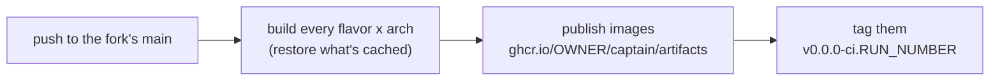

# Custom CaptainOS builds in a fork

A GitHub fork of `tinkerbell/captain` builds and publishes its own CaptainOS images with the same CI
as upstream: push to the fork's `main`, and every flavor gets built (reusing whatever is unchanged),
published as OCI images under the fork's own `ghcr.io` namespace, and versioned
`v0.0.0-ci.<run number>`. Nothing needs a release process, secrets or a separate registry.

## Setting up

1. Fork `tinkerbell/captain` on GitHub.
2. Enable GitHub Actions in the fork (GitHub disables workflows on new forks: **Actions** tab →
   enable them).
3. Push to the fork's `main` (eg. your customizations, see below).

That's it. CI authenticates to `ghcr.io` with the workflow's own `GITHUB_TOKEN`
(`permissions: packages: write`). Packages it creates are linked to the fork and inherit its
visibility: public for a public fork, so they can be pulled anonymously.

## Customizing

Most customizations go in `custom/` (see "Customization via `custom/`" in `README.md`): extra
packages (`custom/packages.txt`), files dropped into the image (`custom/files/`), and post-install /
finalize scripts. They apply to every flavor.

To customize only some flavors, use `custom/by-<axis>/<value>/` dirs, shaped like `custom/`: by
package family, distro, arch, role, output, platform, kernel or flavor (eg. `custom/by-flavor/trixie-slim/`,
`custom/by-arch/arm64/`, `custom/by-role/k8s-capt/`). Matching dirs merge with `custom/`, more specific
ones winning by file/script name; symlink a `custom/by-flavor/` dir to share it between flavors.
Flavors themselves are defined in `captain/flavors.py`.

Commit them to the fork's `main`. `custom/` and each matching `custom/by-*/` dir are part of the
flavor's cache key, so only customized flavors are rebuilt, while unchanged pieces (tools, the
CaptainOS kernel) are reused.

### Building only some flavors

List the flavors CI should build in `custom/builds.txt`, one flavor id or glob per line (eg. `trixie-full`,
`*-armbian-rpi`, `img-k8s-capt-*`). The shipped file lists every flavor commented out; an empty (or all-comments)
file builds them all. Only CI reads it: the build matrix, version tags and GitHub Releases follow it, local builds
don't. A line matching no flavor fails CI's `prepare` job. `uv run captain list-flavors` shows a `ci` column when the
file selects only some.

## What CI does on each push to `main`



- **Build cache**: pieces are looked up in the fork's own cache first
  (`ghcr.io/<owner>/captain/cache/*`), then upstream's (`ghcr.io/tinkerbell/captain/cache/*`, once
  upstream CI publishes one); whatever is built is pushed to the fork's cache. See
  `docs/build-caching.md`. A push that changes no build inputs (eg. docs only) finishes in a few
  minutes.
- **Builder image**: the fork uses its own `ghcr.io/<owner>/captain/builder`, or upstream's when it has
  one for the same `Dockerfile`; it only builds one when neither exists.
- **Images**: published to `ghcr.io/<owner>/captain/artifacts` once per unique content, then tagged
  for the commit (`v0.0.0-<sha7>-<flavor>[-<arch>]`).
- **Version**: the final `release` job tags every flavor's image with `v0.0.0-ci.<run number>` plus
  the flavor's suffix. Run numbers only increase, so consumers always have a newer version to bump
  to. By default this is all it does (it takes under a minute).
- Pull requests (including ones from the fork to upstream) build and test, but never tag versions;
  PRs from other repositories can't push to any cache.

## Image tags

`<owner>` is the fork owner, lowercased. Multi-arch flavors get a multi-arch image (`linux/amd64` and
`linux/arm64`) plus per-arch ones (`-amd64`, `-arm64`); arm64-only flavors get their tag both bare and
with `-arm64`.

| Flavor | Version tag |
|---|---|
| `trixie-full` | `v0.0.0-ci.<n>` (and `-amd64`, `-arm64`) |
| `trixie-slim` | `v0.0.0-ci.<n>-slim` (and `-slim-amd64`, `-slim-arm64`) |
| `trixie-armbian-rpi` | `v0.0.0-ci.<n>-rpi` (and `-rpi-arm64`) |
| `trixie-genio`, `trixie-meson64`, `trixie-rockchip64`, `trixie-rockchip64-vendor` | `v0.0.0-ci.<n>-genio`, `-meson64`, `-rockchip64`, `-rockchip64-vendor` (each also with `-arm64`) |
| other flavors | `v0.0.0-ci.<n>-<flavor id>` (with `-amd64` / `-arm64` for multi-arch ones) |

`uv run captain list-flavors --release` prints the authoritative list (`<id> <target> <arch> <suffix>`).

Every image is also tagged with the flavor id instead of the suffix, exactly like the per-commit tags:
`v0.0.0-ci.<n>-<flavor id>[-<arch>]` (eg. `v0.0.0-ci.<n>-trixie-full`,
`v0.0.0-ci.<n>-trixie-armbian-rpi-arm64`). So references written for per-commit tags
(`v0.0.0-<sha7>-<flavor id>[-<arch>]`) switch to versions by changing only the version part.

Each image's layers are plain files at its root: `vmlinuz-<flavor>-<arch>`,
`initramfs-<flavor>-<arch>`, the ISO and disk image where the flavor has them, `dtb-…/` directories,
`firmware-rpi/` (ready-to-netboot, for the in-memory Raspberry Pi flavors) and
`sha256sums-<flavor>-<arch>.txt`.

## Consuming the images

- **Kubernetes image volumes**: mount the image directly into a pod (on clusters with the
  `ImageVolume` feature), eg. for something serving the kernel and initramfs:

  ```yaml
  volumes:
    - name: captainos
      image:
        reference: ghcr.io/<owner>/captain/artifacts:v0.0.0-ci.<n>
        pullPolicy: IfNotPresent
  ```

- **Files on disk**: `uv run captain --flavor-id <flavor> release --target <combined|amd64|arm64>
  --src-tag v0.0.0-ci.<n><suffix> pull --pull-output <dir>` extracts them under `out/<dir>`
  (`--target <arch>` appends `-<arch>` to the tag; `combined` gets both arches of a multi-arch
  flavor). Any OCI tool works too, eg. `skopeo copy` or `oras pull`.

## Optional: GitHub Releases

To also get a GitHub prerelease per push, with every flavor's artifacts attached (the way upstream's
`v*` tags are released), set the repository variable `CAPTAIN_FORK_GH_RELEASE` to `true` (Settings →
Secrets and variables → Actions → Variables). This adds about ten minutes per run: every flavor is
pulled and uploaded, one at a time.

## Building locally in the fork

A local clone of the fork reads the same caches: `captain` detects the fork from the current branch's
git remote (else `origin`), and tries its cache before upstream's.

```bash
uv run captain cache info          # which caches are read/written, and what's in them
uv run captain build               # restores whatever CI already built
```

Without `--cache-push`, local builds only read caches (the log says `Cache: not pushing (…)` and why),
and a cache hit is downloaded instead of built. To push local builds to the fork's cache, log in with a
token that can write packages (`docker login ghcr.io`) and pass `--cache-push`. Version tokens (kernel, armbian) are resolved like
CI does, so local and CI cache keys match; see `docs/build-caching.md`.

## Without a fork: a repository holding only `custom/`

Instead of forking, keep just your customizations in a repository of your own, eg. `OWNER/my-custom-captain`, whose
root is the contents of `custom/`:

```
my-custom-captain/
├── .github/workflows/build.yml
├── packages.txt
├── files/etc/...
├── mkosi-postinst/10-my-setup.sh
└── by-flavor/trixie-full/...        # custom/by-<axis>/<value>/ dirs work as usual
```

Its workflow checks out upstream `tinkerbell/captain` at a pinned ref, puts the repository in place of `custom/`, and
runs the same `captain` commands as upstream's CI. Everything that depends on the repository follows
`GITHUB_REPOSITORY`, so it lands in `OWNER/my-custom-captain`'s own namespace, with no extra configuration:

| What | Where |
|---|---|
| build cache, read | `ghcr.io/owner/my-custom-captain/cache/*`, then `ghcr.io/tinkerbell/captain/cache/*` |
| build cache, written | `ghcr.io/owner/my-custom-captain/cache/*` (pushes to `main`) |
| builder image | upstream's when it has one for the same `Dockerfile`, else `ghcr.io/owner/my-custom-captain/builder` |
| published images | `ghcr.io/owner/my-custom-captain/artifacts` |

Pin `CAPTAIN_REF` to a commit or tag upstream CI built: then tools, kernels and every piece your customizations don't
touch are restored from upstream's cache, and only the customized flavors are built (and cached in your namespace).
Bumping `CAPTAIN_REF` is how you pick up upstream changes.

### Example: `trixie-full`, both arches

`trixie-full` is multi-arch: each arch is built and published, then combined into one multi-arch image, which is
finally tagged with a version (`v0.0.0-ci.<run number>`, plus `-amd64`/`-arm64` and `-trixie-full` variants).

```yaml
# OWNER/my-custom-captain: .github/workflows/build.yml
name: Build CaptainOS
on:
  push:
    branches: [main]
  workflow_dispatch:

permissions:
  contents: read
  packages: write

env:
  CAPTAIN_REF: main          # pin to an upstream commit or tag that upstream CI built
  FLAVOR_ID: trixie-full
  FORCE_COLOR: "1"
  GIT_SHA: ${{ github.sha }} # per-commit image tags follow this repository, not upstream's checkout

jobs:
  prepare: # resolve version tokens once, so every job computes the same cache keys
    runs-on: ubuntu-latest
    outputs:
      kernel_version: ${{ steps.versions.outputs.kernel_version }}
      armbian_version: ${{ steps.versions.outputs.armbian_version }}
    steps:
      - uses: actions/checkout@v7
        with: { repository: tinkerbell/captain, ref: "${{ env.CAPTAIN_REF }}" }
      - run: rm -rf custom
      - uses: actions/checkout@v7
        with: { path: custom }
      - uses: ./.github/actions/setup-uv
      - id: versions
        run: uv run captain prepare-versions >> "$GITHUB_OUTPUT"
      - run: uv run captain cache info # logs the cache scope and what's already cached

  build:
    needs: prepare
    strategy:
      fail-fast: false
      matrix: { arch: [amd64, arm64] }
    runs-on: ${{ matrix.arch == 'arm64' && 'ubuntu-24.04-arm' || 'ubuntu-latest' }}
    env:
      ARCH: ${{ matrix.arch }}
      TARGET: ${{ matrix.arch }}
      KERNEL_VERSION: ${{ needs.prepare.outputs.kernel_version }}
      ARMBIAN_VERSION: ${{ needs.prepare.outputs.armbian_version }}
    steps:
      - uses: actions/checkout@v7
        with: { repository: tinkerbell/captain, ref: "${{ env.CAPTAIN_REF }}" }
      - run: rm -rf custom
      - uses: actions/checkout@v7
        with: { path: custom }
      - uses: ./.github/actions/setup-uv
      - uses: docker/login-action@v4
        with: { registry: ghcr.io, username: "${{ github.actor }}", password: "${{ secrets.GITHUB_TOKEN }}" }
      - run: uv run captain builder --push --ensure-remote # no-op when upstream (or you) already has it
      - id: release
        run: uv run captain release status --github-output >> "$GITHUB_OUTPUT"
      - if: steps.release.outputs.published != 'true'
        run: uv run captain build # restores whatever is cached, builds the rest
      - run: uv run captain release publish

  publish-combined:
    needs: [prepare, build]
    runs-on: ubuntu-latest
    env:
      TARGET: combined
      CAPTAIN_CACHE_ONLY: "1" # both arches were just built and cached: restore, never build
      KERNEL_VERSION: ${{ needs.prepare.outputs.kernel_version }}
      ARMBIAN_VERSION: ${{ needs.prepare.outputs.armbian_version }}
    steps:
      - uses: actions/checkout@v7
        with: { repository: tinkerbell/captain, ref: "${{ env.CAPTAIN_REF }}" }
      - run: rm -rf custom
      - uses: actions/checkout@v7
        with: { path: custom }
      - uses: ./.github/actions/setup-uv
      - uses: docker/login-action@v4
        with: { registry: ghcr.io, username: "${{ github.actor }}", password: "${{ secrets.GITHUB_TOKEN }}" }
      - id: release
        run: uv run captain --arch amd64 release status --github-output >> "$GITHUB_OUTPUT"
      - if: steps.release.outputs.published != 'true'
        run: |
          uv run captain --arch amd64 build
          uv run captain --arch arm64 build
      - run: uv run captain --arch amd64 release publish
      - run: uv run captain --arch amd64 release tag --new-tag "v0.0.0-ci.${{ github.run_number }}"
```

Then pull it like any other Captain image, eg. `ghcr.io/owner/my-custom-captain/artifacts:v0.0.0-ci.<n>` (see
"Consuming the images" above).

- The custom checkout lands in `custom/`, replacing upstream's examples; its `.git/` is ignored.
- An arm64-only flavor (eg. `trixie-armbian-rpi`) needs only the `build` job, with `matrix: { arch: [arm64] }`, plus
  the tag step there (`release tag --new-tag "v0.0.0-ci.<n><suffix>"`, the suffix from `captain list-flavors
  --release`, eg. `-rpi`).
- More flavors: repeat the jobs per flavor, or generate the matrices like upstream's `ci.yml` does with
  `uv run captain list-flavors --github-output` (honoring your `builds.txt`).
- Customization changes rebuild only the flavors they apply to; upstream changes arrive when you bump `CAPTAIN_REF`.

### Locally

```bash
git clone https://github.com/tinkerbell/captain && cd captain
rm -rf custom && ln -s ../my-custom-captain custom   # your repository, as custom/
export CAPTAIN_CACHE_DOWNSTREAM=ghcr.io/owner/my-custom-captain   # read your cache too (before upstream's)
uv run captain --flavor-id trixie-full build                       # add --cache-push to write to it
```

The local clone's git remote is upstream's, so `CAPTAIN_CACHE_DOWNSTREAM` points the cache at your namespace instead.
Docker-mode builds mount `custom/` through the symlink: on macOS, keep the target in a directory shared with the Docker
VM (eg. under your home directory with colima/Docker Desktop defaults).
